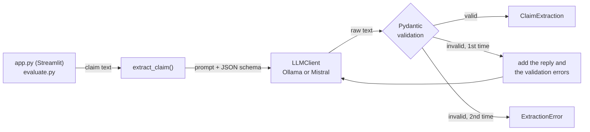

# claim-extractor

Turn free-text customer claims into structured, validated data with an LLM, and measure how
reliable that is.

> « Mon pass Navigo a été débité deux fois le 3 octobre, 86,40 €, je veux être remboursé. »

```json
{
  "type_demande": "remboursement",
  "montant": 86.4,
  "date_incident": "2026-10-03",
  "urgence": "moyenne",
  "resume": "Le pass Navigo du client a été débité deux fois le 3 octobre.",
  "confiance": 0.9
}
```

*(Illustrative output. The four objective fields are the labelled answer for this claim in the
evaluation set.)*

## The problem

A customer service receives claims as free text: emails, contact forms, messages. Before anyone
can act on them, someone has to read each one and work out what is asked, how much money is
involved, when it happened and how urgent it is. That triage is slow and inconsistent.

An LLM can read the text, but its raw output cannot go straight into a workflow: it may return
invalid JSON, invent a category, write `"86,40"` instead of `86.4`, or forget a field. This project
treats the LLM as an **untrusted component** and wraps it in the same engineering you would apply
to any external data source: a strict contract, validation, a bounded retry, logging and an
evaluation set.

## Architecture



| Module | Role |
|---|---|
| `models.py` | `ClaimExtraction`, the output contract (Pydantic) |
| `extractor.py` | Prompt, validation, single corrective retry, one log line per LLM call |
| `llm/base.py` | `LLMClient` interface: chat messages in, raw text out |
| `llm/ollama.py`, `llm/mistral.py` | The two backends, over plain HTTP (httpx) |
| `config.py` | Settings from `.env`, choice of backend |
| `evaluation.py` | Loading the labelled set, per-field scoring, report |
| `batch.py` | CSV reading and writing, batch extraction with a status per row |

## Technical choices

**The Pydantic model is the single source of truth.** `ClaimExtraction` validates the output,
and its JSON schema (field descriptions included) is both pasted into the prompt and sent to the
backend to constrain generation. Changing the model changes the contract everywhere.

**Strict contract.** Every field is required, including the nullable ones: the model must write
`"montant": null` rather than omit the key, so a forgotten field is an error, not a silent `None`.
Unknown keys are rejected (`extra="forbid"`), and amounts, confidence and summary length are
bounded.

**Defence in depth.** Temperature 0 for the most stable answers, schema-constrained decoding on both
backends, then Pydantic validation anyway: constrained decoding guarantees the structure, not
every rule (bounds, real dates, allowed values on every backend version).

**One retry, with the reason.** If validation fails, the model gets its own answer back with the
validation errors, once. A second failure raises `ExtractionError`, which carries the raw output
for debugging. Transport errors (`LLMError`) are *not* retried this way: there is no answer to
correct, and repeating a call to a server that is down only doubles the wait.

**A small backend interface.** `LLMClient` has one method, so the extraction logic does not know
which provider it talks to; adding Mistral after Ollama changed no other code. Backends call the
HTTP APIs directly with httpx rather than through SDKs: every request field (temperature, schema,
streaming off) is visible, and tests swap the network for `httpx.MockTransport`.

**Secrets stay out of the code.** Configuration is read by pydantic-settings from environment
variables and a git-ignored `.env`. The API key is a `SecretStr` (masked when printed), only ever
placed in the `Authorization` header, and never included in error messages, which tests check.

**Observable.** Each LLM call writes one `key=value` log line with the model, attempt, duration
and outcome (`success` at INFO level, `invalid_output` or `llm_error` at WARNING):

```
INFO claim_extractor.extractor llm_call model=qwen2.5:3b attempt=1 duration_ms=1526 outcome=success
```

The package never configures logging itself; the entry points (`app.py`, `evaluate.py`) do.

**Built for real CSV files.** Separator `,` or `;`, UTF-8 or the Windows-1252 encoding French Excel
uses, every cell read as text (`"007"` stays `"007"`), one status per row so a bad claim never
loses the batch, and an output file that opens directly in a French Excel.

**Tested without any network.** A scripted `FakeLLM` drives the extraction and retry logic,
`httpx.MockTransport` stands in for the HTTP APIs, and Streamlit's `AppTest` runs the interface
headless. The suite runs with pytest, mypy in strict mode and ruff.

## Evaluation

`data/eval_set.jsonl` holds 20 labelled claims covering every request type and urgency level,
with deliberate traps: an amount written in words, two amounts in one claim, relative dates
("hier", "jeudi dernier"), a claim received in January about "le 28 décembre", a future date that
is not an incident, SMS-style text. Each line also carries the date the claim was received, used
as "today" so relative dates have one right answer, and a note explaining tricky labels.

How it is scored:

- **Valid JSON**: share of claims that produced a valid `ClaimExtraction`, retry included.
- **Field accuracy** for `type_demande`, `montant`, `date_incident` and `urgence`. An invalid
  output counts as wrong on every field, so a model cannot score well by failing on hard cases.
  Amounts match to within half a cent, and `null` is not `0`.
- `resume` and `confiance` are not scored: they have no single right answer.

### Results

`qwen2.5:3b` through Ollama 0.40.11 on a laptop (Ryzen 7 4800H, GeForce GTX 1660 Ti), five runs
of `python evaluate.py`:

| Metric | qwen2.5:3b (Ollama), 5 runs | mistral-small-latest (API) |
|---|---|---|
| Valid JSON | 100% | not run yet |
| `type_demande` | 65–70% | not run yet |
| `montant` | 95% | not run yet |
| `date_incident` | 55–60% | not run yet |
| `urgence` | 35–40% | not run yet |
| Mean duration per claim | 1.7 s (model loaded; the first call, which loads it, took 9.6 s) | not run yet |

What the mismatches show (`evaluate.py` lists every one of them):

- **The format is solved, the meaning is not.** Every output was valid JSON, and in the logged
  run all 20 calls passed validation on the first attempt: with schema-constrained decoding the
  retry never fired. All the errors are about meaning.
- **One default category.** Every `type_demande` error is `reclamation_service`: three of the
  four lost-item claims (the fourth too in one run), the compliment, the data-deletion request
  and a question.
- **Urgency is overestimated.** Of the 12 urgency errors seen in every run, 10 answer `haute`.
- **Dates are the weakest point of a 3B model.** It invents years ("le 18 octobre" becomes
  2018-10-18 although the prompt gives today's date), miscomputes relative dates ("jeudi
  dernier" lands in April) and makes up a date when there is none ("depuis juillet", a question
  about a future day).
- **The only amount error is debatable**: c15 quotes a price in a question, and the label says to
  report it.
- **Temperature 0 is not bit-for-bit deterministic.** Runs 2 to 5 were identical, but the first
  one differed on 3 of the 80 field checks.

Next steps these results point to: a larger model (`qwen2.5:7b`, Mistral), relative dates
computed in code instead of by the model, and a few examples in the prompt for `perte`, `autre`
and the urgency levels.

## Getting started

Requires Python 3.11+.

```bash
python -m venv .venv
source .venv/bin/activate        # Windows PowerShell: .venv\Scripts\Activate.ps1
pip install -e ".[dev]"
cp .env.example .env
```

Then choose a backend in `.env`:

- **Ollama (local, free):** install [Ollama](https://ollama.com) (0.5 or later, for structured
  outputs), then `ollama pull qwen2.5:3b`. Keep `LLM_PROVIDER=ollama`. With more memory and
  disk, `qwen2.5:7b` (set `OLLAMA_MODEL`) is more accurate.
- **Mistral API:** set `LLM_PROVIDER=mistral` and `MISTRAL_API_KEY=...`.

Run the interface (paste a claim, or upload a CSV and download the result):

```bash
streamlit run app.py
```

The CSV needs a header row and one claim per line. The text column is detected by name
(`texte`, `text`, `reclamation`, `message`) and can be changed in the interface. The result keeps
the original columns and adds `statut` (`ok`, `texte_vide`, `sortie_invalide`), `erreur` and the
extracted fields.

Run the evaluation:

```bash
python evaluate.py
```

Development:

```bash
ruff check .        # lint
ruff format .       # format
mypy                # type-check (strict)
pytest              # tests, no network needed
```

## Project layout

```
app.py                     Streamlit interface
evaluate.py                evaluation entry point
data/eval_set.jsonl        20 labelled claims
src/claim_extractor/       application code (see the module table above)
tests/                     pytest suite: fake LLM, mocked HTTP, headless app
.env.example               configuration template (copy to .env)
```

## Limitations

- **Small evaluation set, one annotator.** 20 claims give a rough signal, not a precise score.
  The same person wrote the labels and the prompt rules, so the prompt may fit this set better
  than real traffic.
- **Not bit-for-bit reproducible.** Even at temperature 0, a local model can change a few answers
  from one run to the next (3 of 80 field checks here), so one run is not a precise score.
- **Self-reported confidence.** `confiance` is the model's own estimate and is not calibrated.
- **Money as `float`.** Fine for display and comparison to the cent; `Decimal` would be the
  rigorous type for accounting.
- **No backoff on transient errors.** A 429 or 503 from the API stops the call instead of being
  retried after a delay.
- **Sequential batch.** CSV rows are processed one at a time; a large file with a local model
  takes a while.
- **"Today" in the interface is the current date.** Relative dates in a CSV are resolved against
  the day of processing, not the day each claim was received.
- **French only.** Prompt, categories and test data assume French claims.

## Possible improvements

- Resolve relative dates ("hier", "jeudi dernier") in code from the reception date, and let the
  model only extract the expression.
- A few examples in the prompt for the weakest categories (`perte`, `autre`, urgency levels).
- A larger evaluation set labelled by two people, with their agreement measured.
- Measure validity on the first attempt as well, to quantify what the retry brings.
- Retry with exponential backoff for transient HTTP errors (429, 503, timeouts).
- Concurrent batch processing with a rate limit.
- Score `resume` with an LLM-as-judge, and check whether `confiance` predicts correctness.
- An optional reception-date column in the CSV.
- CI running ruff, mypy and pytest on every push; a Dockerfile for the app.
